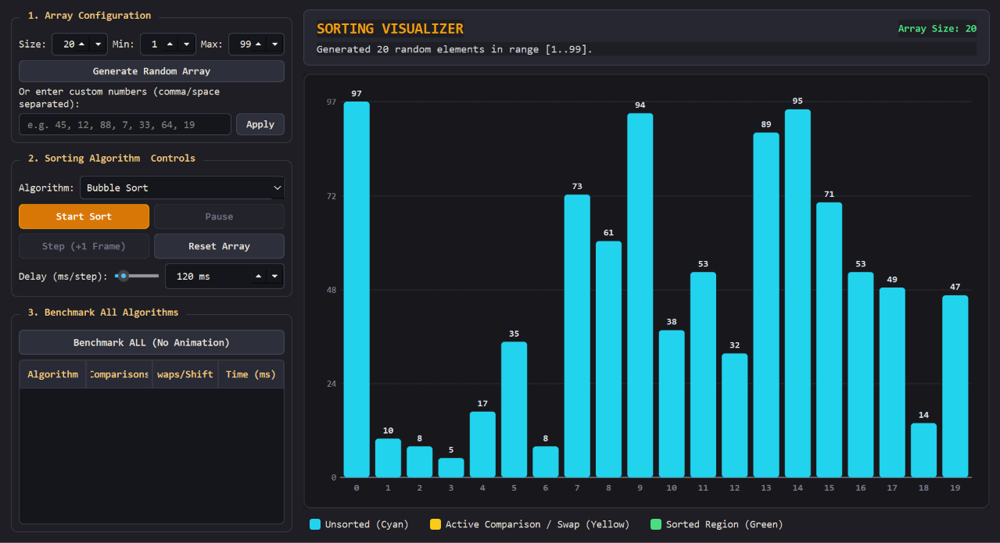
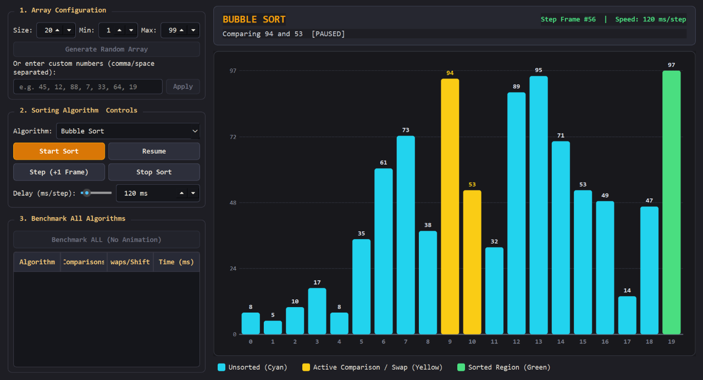
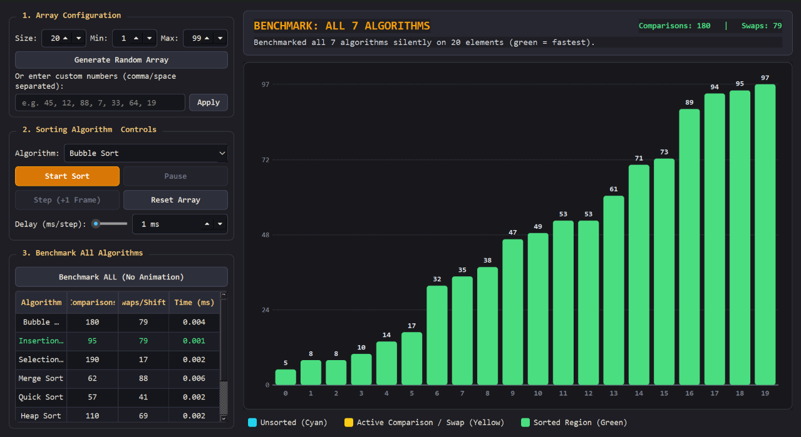

# Sorting Visualizer (Qt6 / Qt5 C++17 GUI + CLI)

An animated sorting algorithm visualizer written in C++17 with a full **Qt Widgets GUI** (plus the original ANSI terminal CLI mode via `--cli`).


## 📸 Screenshots

### Main Interface


### Sorting in Action


### Benchmark Results


## Features
- **7 Sorting Algorithms**: Bubble, Insertion, Selection, Merge, Quick, Heap, and Shell sort (`Sorting.cpp` is 100% preserved and decoupled via `Renderer` callbacks).
- **Custom QPainter Bar Chart (`BarChartWidget`)**:
  - **Cyan**: Unsorted elements
  - **Yellow**: Active comparison / swap indices (`a`, `b`)
  - **Green**: Sorted region (`sortedBoundary`)
- **Interactive Playback Controls**: Start, Pause/Resume, single-step (`Step (+1 Frame)`), Stop/Reset, and real-time speed slider (`1–1000 ms/step`).
- **Flexible Array Input**: Generate random arrays (custom size and min/max range) or enter custom comma/space-separated values.
- **Benchmark All Table**: Runs all 7 algorithms silently (`visualize = false`) on the same input array and compares Comparisons, Swaps/Shifts, and Time (ms), highlighting the fastest algorithm.

## Build on Windows (MSYS2 UCRT64 / MinGW64)

### 1. Install Qt6 (if not already installed in MSYS2)
```bash
pacman -S mingw-w64-ucrt-x86_64-qt6-base mingw-w64-ucrt-x86_64-cmake mingw-w64-ucrt-x86_64-ninja
```

### 2. Build with CMake (Recommended)
```bash
mkdir build && cd build
cmake .. -G "Ninja" -DCMAKE_BUILD_TYPE=Release
cmake --build .
./sorting_visualizer.exe
```

### 3. Or Build Directly with g++ (Single Command)
Because all signal connections use C++17 lambdas/functors without requiring separate `moc` code generation, you can also compile directly with `g++`:
```bash
g++ -std=c++17 -O2 -Iinclude src/*.cpp -o sorting_visualizer.exe $(pkg-config --cflags --libs Qt6Widgets)
./sorting_visualizer.exe
```

### Run Original Terminal Mode
```bash
./sorting_visualizer.exe --cli
```
